# Civic Issue Heatmap Platform

[](https://openjdk.org/projects/jdk/21/)
[](https://spring.io/projects/spring-boot)
[](https://postgis.net/)
[](https://leafletjs.com/)
[](LICENSE)

An enterprise-grade, geospatial municipal issue reporting, automated deduplication, algorithmic prioritization, auto-routing, and hotspot analytics platform built with **Spring Boot 3.3.4**, **PostgreSQL 16 / PostGIS 3.4**, and a responsive **Leaflet.js** frontend.

---

## 📸 Screenshots & UI Preview

| Interactive Heatmap & Hotspot Side Panel | Geotagged Complaint Submission |
| :---: | :---: |
|  *(Full-screen map with dynamic heatmap & hotspot fly-to)* |  *(Location pin drop, category selector & image upload)* |

| Department Officer & Admin Dashboard | Real-Time Analytics & Trends |
| :---: | :---: |
|  *(Status update modal, department filtering & severity tags)* |  *(Category distribution, department breakdown & resolution times)* |

---

## 🌟 Key Features

- 📍 **Geotagged Incident Reporting**: Citizens submit reports with GPS coordinates, reverse geocoded addresses, and up to 4 image attachments.
- 🔍 **Hybrid Duplicate Detection**: Spatial radius query (`ST_DWithin`) combined with Jaccard token similarity automatically merges redundant complaints, increments upvotes, and links parent records.
- ⚡ **Algorithmic Severity Engine**: Calculates a dynamic $0-100$ severity score based on category weight, local incident density, community upvotes, emergency keywords, and ticket age.
- 🏛️ **Automated Department Routing**: Directs complaints to municipal departments (`Roads & Infrastructure`, `Sanitation`, `Electricity`, `Water Supply`, `Pollution Control`) based on issue taxonomy.
- 🗺️ **Grid Hotspot Clustering & Heatmap**: Aggregates spatial incidents into uniform grid cells to calculate centroids, dominant categories, and heat intensities for Leaflet.heat rendering.
- 🔐 **Role-Based Access Control (RBAC)**: Stateless JWT authentication supporting `CITIZEN`, `OFFICER`, and `ADMIN` personas with strict status lifecycle transitions.
- 🛡️ **Hardened Architecture**: Request ID correlation via MDC filter, sliding-window rate limiting (HTTP 429), path traversal defense, and Spring Boot Actuator metrics.
- 🧪 **Realistic Dev Data Seeder**: Pre-seeds ~300 realistic civic incidents across city corridors under the `dev` profile.

---

## 🏗️ System Architecture

```mermaid
flowchart TD
    subgraph Clients["Frontend Clients"]
        UI["Citizen Web UI (Leaflet.js + Vanilla JS)"]
        Dash["Officer & Admin Dashboard (Chart.js)"]
    end

    subgraph Security["Security & Cross-Cutting Layer"]
        MDC["MdcLoggingFilter (X-Request-Id)"]
        RL["RateLimiter (Sliding Window Bucket)"]
        JWT["JwtAuthFilter (Stateless RBAC)"]
    end

    subgraph API["REST Controllers (/api/v1)"]
        AuthCtrl["AuthController"]
        CompCtrl["ComplaintController"]
        HeatCtrl["HeatmapController"]
        DeptCtrl["DepartmentController"]
        AdminCtrl["AdminController"]
        FileCtrl["FileController"]
    end

    subgraph Engines["Domain Strategy Engines"]
        DupEng["DuplicateDetector\n(GeoTextDuplicateDetector)"]
        SevEng["SeverityCalculator\n(WeightedSeverityCalculator)"]
        RoutEng["RoutingStrategy\n(CategoryRoutingStrategy)"]
        ClustEng["HotspotClusterer\n(GridHotspotClusterer)"]
    end

    subgraph Persistence["Data & Spatial Layer"]
        Repo["Spring Data JPA Repositories"]
        Flyway["Flyway SQL Migrations"]
        Spatial["Hibernate Spatial 6.5"]
    end

    subgraph DB["Database"]
        PG[("PostgreSQL 16 + PostGIS 3.4\nGiST Spatial Indexes")]
    end

    Clients --> Security
    Security --> API
    API --> Engines
    Engines --> Persistence
    Persistence --> DB
```



---

## 🔬 Core Algorithms & Mathematical Formulations

### 1. Hybrid Duplicate Detection Algorithm
When a citizen files a complaint, candidate complaints matching the same category within $R$ meters (default: $50\text{m}$) submitted within the last $W$ days (default: $14\text{ days}$) are fetched via PostGIS `ST_DWithin`.

For each candidate, a composite similarity score $S \in [0.0, 1.0]$ is computed:
$$S = 0.6 \cdot \left(1.0 - \frac{\text{Distance}(\text{new}, \text{candidate})}{R}\right) + 0.4 \cdot J(\text{Tokens}_{\text{new}}, \text{Tokens}_{\text{candidate}})$$

Where $J(A, B)$ is the Jaccard similarity between normalized alphanumeric word token sets:
$$J(A, B) = \frac{|A \cap B|}{|A \cup B|}$$

- **Threshold**: If $\max(S) \ge 0.65$, the incoming report is marked as `DUPLICATE`, linked via `duplicateOf`, and the original complaint's upvote count is incremented.

---

### 2. Multi-Factor Severity Scoring Formula
The severity calculator outputs a composite score from $0$ to $100$:

$$\text{Severity Score} = \min\left(100, W_{\text{base}} + S_{\text{upvotes}} + S_{\text{density}} + S_{\text{keywords}} + S_{\text{age}}\right)$$

Where:
- **Base Weight ($W_{\text{base}}$)**: `WATER_LEAK` (40), `POTHOLE` (35), `STREETLIGHT` (30), `GARBAGE` (25), `NOISE` (15).
- **Community Signals ($S_{\text{upvotes}}$)**: $\min(15, \text{upvotes} \times 3)$.
- **Density Boost ($S_{\text{density}}$)**: Open complaints within $200\text{m}$ (capped at 20 points, 4 pts/complaint).
- **Emergency Keywords ($S_{\text{keywords}}$)**: +5 points per matching keyword (`accident`, `hazard`, `flooding`, `hospital`, `school`, `collapsed`, `sparking`, `children`, `dangerous`, etc., capped at 15 points).
- **Aging Factor ($S_{\text{age}}$)**: $+1.5\text{ points/day}$ unresolved (capped at 15 points).

#### Severity Levels:
- **LOW**: $0 - 24$
- **MEDIUM**: $25 - 49$
- **HIGH**: $50 - 74$
- **CRITICAL**: $75 - 100$

---

## 🛠️ Tech Stack

| Component | Technology | Version |
| :--- | :--- | :--- |
| **Language** | Java (OpenJDK) | 21 LTS |
| **Backend Framework** | Spring Boot | 3.3.4 |
| **Security** | Spring Security + JJWT | 6.3.3 / 0.12.6 |
| **Database & GIS** | PostgreSQL + PostGIS Extension | 16-3.4 |
| **Spatial ORM** | Hibernate Spatial + JTS | 6.5.3 / 1.19.0 |
| **Database Migrations** | Flyway Core | 10.10.0 |
| **API Documentation** | SpringDoc OpenAPI (Swagger UI) | 2.6.0 |
| **Frontend UI** | HTML5, Vanilla CSS3, JavaScript (ES6+) | Modern Web |
| **Map & Heatmap** | Leaflet.js + Leaflet.heat | 1.9.4 / 0.2.0 |
| **Charts & Metrics** | Chart.js | 4.4.1 |
| **Testing** | JUnit 5, Mockito, Testcontainers PostGIS | 5.10 / 1.20 |

---

## 🚀 Getting Started

### Prerequisites
- **JDK 21+**
- **Apache Maven 3.9+**
- **Docker & Docker Compose** (optional for containerized setup)

---

### Option A: Run with Docker Compose (Recommended)

1. Clone the repository:
   ```bash
   git clone https://github.com/your-org/civic-issue-heatmap.git
   cd civic-issue-heatmap
   ```

2. Build and launch all services:
   ```bash
   docker compose up --build -d
   ```

3. Access the web interface at:
   - 🌐 **Web Portal**: [http://localhost:8080](http://localhost:8080)
   - 📝 **Report Issue**: [http://localhost:8080/report.html](http://localhost:8080/report.html)
   - 📊 **Officer & Admin Dashboard**: [http://localhost:8080/dashboard.html](http://localhost:8080/dashboard.html)
   - 📖 **Swagger API Docs**: [http://localhost:8080/swagger-ui.html](http://localhost:8080/swagger-ui.html)
   - 🩺 **Actuator Health**: [http://localhost:8080/actuator/health](http://localhost:8080/actuator/health)

---

### Option B: Run Locally with Maven

1. Start the PostGIS database container:
   ```bash
   docker compose up -d postgis
   ```

2. Run the application with the `dev` profile (enables auto-seeder & admin account):
   ```bash
   mvn clean spring-boot:run -Dspring-boot.run.profiles=dev
   ```

3. Run the automated test suite:
   ```bash
   mvn test
   ```

---

## 🔑 Default Credentials (Dev Profile)

| Persona | Email | Password | Role |
| :--- | :--- | :--- | :--- |
| **System Administrator** | `admin@civicheat.gov` | `Admin@123` | `ADMIN` |
| **Demo Citizen** | Self-register at `/login.html` | *Custom* | `CITIZEN` |

---

## ⚙️ Environment Variables & Configuration

| Variable | Description | Default Value |
| :--- | :--- | :--- |
| `SERVER_PORT` | HTTP port for Spring Boot application | `8080` |
| `SPRING_DATASOURCE_URL` | JDBC URL for PostgreSQL PostGIS instance | `jdbc:postgresql://localhost:5432/civicheat` |
| `SPRING_DATASOURCE_USERNAME` | Database username | `postgres` |
| `SPRING_DATASOURCE_PASSWORD` | Database password | `postgres` |
| `CIVIC_HEAT_JWT_SECRET` | 256-bit secret key for HMAC token signing | `404E635266556A586E3272357538782F413F4428472B4B6250645367566B5970` |
| `CIVIC_HEAT_JWT_EXPIRY_HOURS` | JWT token lifespan in hours | `24` |
| `CIVIC_HEAT_UPLOAD_DIR` | Local directory for storing image uploads | `./uploads` |
| `CIVIC_HEAT_DUPLICATE_RADIUS`| Search radius in meters for duplicate detection | `50.0` |
| `CIVIC_HEAT_DUPLICATE_DAYS` | Temporal search window in days for duplicates | `14` |
| `CIVIC_HEAT_DUPLICATE_THRESHOLD` | Composite score threshold for auto-merge | `0.65` |
| `CIVIC_HEAT_SEEDER_CENTER_LAT` | Latitude for demo complaint generator | `37.7749` |
| `CIVIC_HEAT_SEEDER_CENTER_LNG` | Longitude for demo complaint generator | `-122.4194` |

---

## 📡 REST API Summary

### Authentication (`/api/v1/auth`)
| Method | Endpoint | Access | Description |
| :--- | :--- | :--- | :--- |
| `POST` | `/api/v1/auth/register` | Public | Register new Citizen account |
| `POST` | `/api/v1/auth/login` | Public | Authenticate user and obtain JWT token |
| `GET` | `/api/v1/auth/me` | Authenticated | Fetch profile details of current user |

### Complaints (`/api/v1/complaints`)
| Method | Endpoint | Access | Description |
| :--- | :--- | :--- | :--- |
| `POST` | `/api/v1/complaints` | Citizen / Authenticated | Submit multipart complaint + up to 4 images |
| `GET` | `/api/v1/complaints/{id}` | Public | Get complaint details, history & severity breakdown |
| `GET` | `/api/v1/complaints` | Public | Paginated complaint query with multi-attribute filtering |
| `POST` | `/api/v1/complaints/{id}/upvote` | Citizen / Authenticated | Upvote a complaint (1 vote per citizen) |
| `GET` | `/api/v1/complaints/mine` | Citizen / Authenticated | Fetch paginated complaints submitted by logged-in citizen |
| `PATCH` | `/api/v1/complaints/{id}/status` | Officer (own dept) / Admin | Transition complaint lifecycle status |
| `POST` | `/api/v1/complaints/{id}/reassign` | Admin Only | Reassign complaint to another department |

### Heatmap & Analytics (`/api/v1/heatmap`)
| Method | Endpoint | Access | Description |
| :--- | :--- | :--- | :--- |
| `GET` | `/api/v1/heatmap/points` | Public | Lightweight `[lat, lng, weight]` array for Leaflet.heat |
| `GET` | `/api/v1/heatmap/hotspots` | Public | Ranked grid-clustered hotspot list with centroids & intensities |
| `GET` | `/api/v1/heatmap/stats` | Public | Category totals, department workload, and resolution metrics |

### Department Management (`/api/v1/departments`)
| Method | Endpoint | Access | Description |
| :--- | :--- | :--- | :--- |
| `GET` | `/api/v1/departments` | Public | List all active municipal departments |
| `GET` | `/api/v1/departments/{id}/complaints` | Authenticated | Paginated list of complaints for a specific department |
| `POST` | `/api/v1/admin/officers` | Admin Only | Provision a new Departmental Officer account |

### Media Attachments (`/api/v1/files`)
| Method | Endpoint | Access | Description |
| :--- | :--- | :--- | :--- |
| `GET` | `/api/v1/files/{filename}` | Public | Stream or download uploaded image attachment |

---

## 📚 Supplementary Documentation

- 🏛️ **[docs/architecture.md](docs/architecture.md)**: In-depth breakdown of architectural tiers, design patterns, spatial indices, and security model.
- ⚡ **[docs/api-examples.http](docs/api-examples.http)**: Ready-to-use HTTP request examples for VS Code REST Client or IntelliJ HTTP Client.

---

## 📄 License
This project is open-source under the [MIT License](LICENSE).
